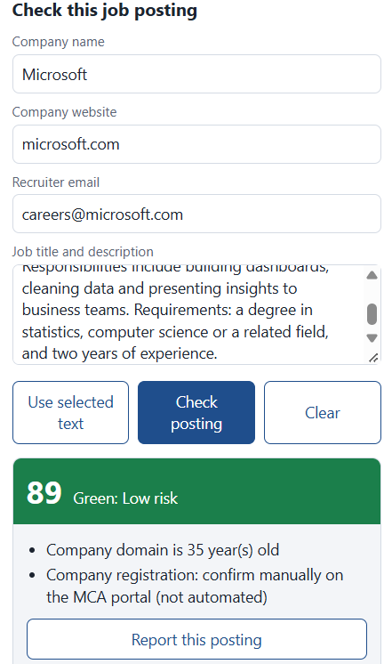
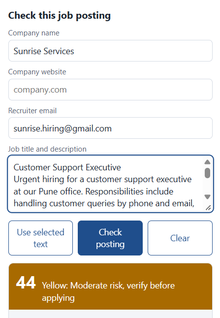
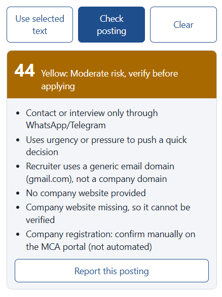
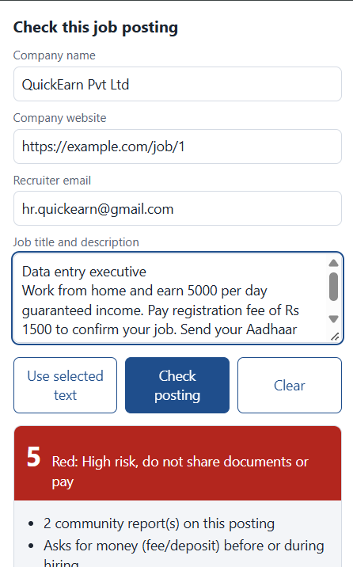
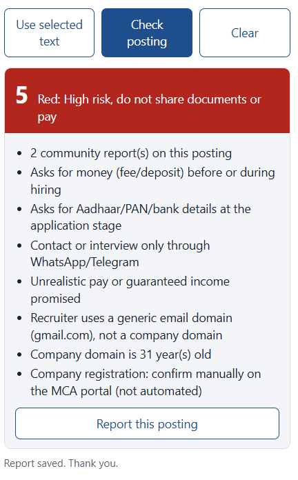
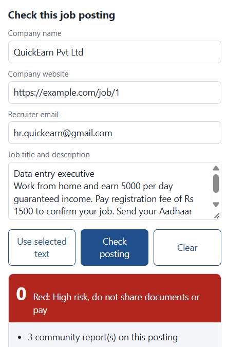
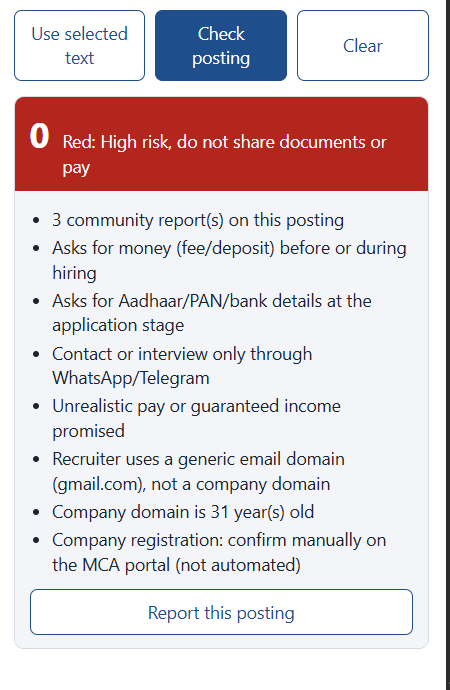

# Job Posting Trust Check

A Chrome extension that checks a job posting for signs of fraud and gives it a trust score from 0 to 100, with the reasons.

- **Green (70+):** low risk
- **Yellow (40 to 69):** be careful, verify first
- **Red (below 40):** high risk, do not pay or share documents

## What it looks like

**Green: a genuine posting (score 89)**



**Yellow: moderate risk (score 44)**

| Details entered | Result |
|---|---|
|  |  |

**Red: a scam posting (score 5)**

| Details entered | Result |
|---|---|
|  |  |

**Red after more reports: the score drops to 0**

If you click **Report this posting**, later checks of the same posting or company score lower.

| Details entered | Result |
|---|---|
|  |  |

## How it works

You enter the company name, website, recruiter email and job description in the extension, or select the text on a page like LinkedIn. It sends them to a small Python backend running on your computer, which checks:

1. **Red-flag rules:** asking for money, asking for Aadhaar/PAN/bank details, WhatsApp-only contact, "guaranteed" pay, urgency, a Gmail/Yahoo recruiter email, no company website.
2. **Machine learning (optional):** a model trained on the EMSCAD fake job postings dataset.
3. **Website check:** does the website open, and how old is the domain?
4. **Reports:** you can report a fake posting, and later checks of the same posting or company score lower.

## Setup

You need **Python 3.10 or newer** and **Google Chrome** on a computer.

1. Download this repo (Code, then Download ZIP, or `git clone`) and open the folder in a terminal.
2. In the main project folder, install the libraries:
   ```
   python -m venv venv
   venv\Scripts\activate
   pip install -r requirements.txt
   ```
   (On Mac/Linux use `source venv/bin/activate`.)
3. Start the backend and **keep this window open** whenever you use the extension:
   ```
   cd backend
   uvicorn app:app --reload
   ```
4. In Chrome, open `chrome://extensions`, turn on **Developer mode**, click **Load unpacked**, and choose the `extension` folder.

The tool works without the machine learning model, using only the rules and website checks. To train the model, download `fake_job_postings.csv` from [Kaggle](https://www.kaggle.com/datasets/shivamb/real-or-fake-fake-jobposting-prediction), put it in the `data` folder, and run this from the main project folder:

```
python backend/train_model.py data/fake_job_postings.csv
```

Then restart the backend.

## How to use

1. Make sure the backend is running (step 3). Keep that window open.
2. Open a job posting and click the extension icon.
3. Fill in the company name, website and recruiter email. Leave the website empty if the posting doesn't give one. Paste the job description, or select it on the page and click **Use selected text**.
4. Click **Check posting**. You get a score, a colour and the reasons.
5. If you think the posting is fake, click **Report this posting**.
6. Click **Clear** before checking the next posting.

## Limitations

- Tested only on desktop Chrome on Windows. It does not work on phones.
- The backend is not hosted online. It only works while you are running it on your own computer, and reports are saved only on that computer.
- The score is a warning, not proof. Always check a company yourself before paying or sharing documents.
- Company registration is not checked automatically. The tool reminds you to check it on the MCA portal.

This is a student project for learning and demonstration.
